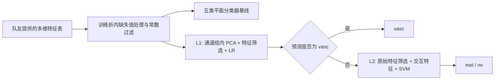
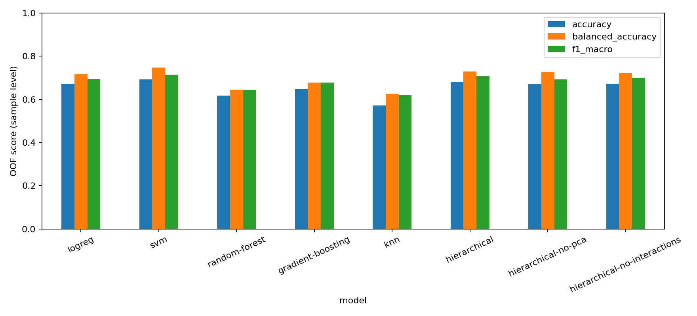

# 简化工程示例（独立于原方法复核）
> 本页保留此前简化实现的接口与验证记录。其 F-test / LR→SVM 配置不是原版方法的等价复现，0.706 不代表原方法的重新评估结果。原方法、原始数据复核和展示结论以 [仓库首页](README.md) 与 [复核报告](reports/reassessment/README.md) 为准。


**基于多维手工特征的皮肤病变三分类：分类器设计、性能优化与分组评估。**

这是皮肤病变分类课程项目中传统机器学习部分的个人贡献展示版。输入为团队上游模块生成的特征表，输出为 `mel`（黑色素瘤）、`nv`（色素痣）或 `vasc`（血管性病变）。

## 我的贡献

> 我负责基于队友提取的多维特征，进行传统机器学习分类器的设计与性能优化，包括基线模型对比、两层分类架构、特征筛选与降维策略、交互特征实验，以及性能评估与误差分析。

| 工作环节 | 本仓库呈现的内容 | 贡献边界 |
| --- | --- | --- |
| 图像预处理与特征提取 | 约定输入特征表格式 | 团队上游工作，作为输入依赖 |
| 基线分类器 | LR、RBF-SVM、RF、Gradient Boosting、KNN | 我的分类建模工作 |
| 层次分类 | L1 区分 vasc / 非 vasc；L2 区分 mel / nv | 我的分类架构与优化工作 |
| 特征优化实验 | mRMR 近似筛选、L1 通道组内 PCA、L2 交互特征 | 分类阶段的性能优化 |
| 模型评估 | 按原图分组、嵌套调参、OOF 预测、混淆矩阵与消融 | 我的实验评估工作 |
| GitHub 整理 | 独立命令行、输入校验、回归测试、结果溯源 | 在原课程代码基础上的后续工程整理 |

该范围依据原代码与个人职责说明整理；未将上游特征提取或课程项目中的深度学习部分归为个人独立成果。原材料中的 AI 辅助过程文件不属于运行依赖，未打包进展示仓库。

## 方法



- **非对称特征空间**：第一层尝试 PCA 降维，第二层保留原始特征空间，检验两项任务是否需要不同的特征表示。
- **mRMR 近似**：互信息度量相关性，绝对 Pearson 相关性惩罚冗余，沿用原项目的近似思路。
- **交互特征**：通过 F-test 与 RF 重要性差异选择互补候选，生成乘积、比值、差值，再用互信息筛选。这些候选族是统计启发式，不等同于经验证的解剖或病理类别。
- **类别不平衡**：LR、SVM 和 RF 使用平衡类别权重；同时报告 Macro-F1、Balanced Accuracy 与各类召回率。

## 快速运行

Python 3.10+，建议使用独立虚拟环境。在本仓库根目录执行：

```bash
python -m venv .venv
# Windows PowerShell: .venv\Scripts\Activate.ps1
# macOS / Linux: source .venv/bin/activate
python -m pip install -e .

# 无需原始数据：用合成特征检查端到端流程
python -m skin_lesion_ml demo
python -m skin_lesion_ml evaluate --data data/demo_features.csv --models logreg hierarchical --selection f --folds 3 --inner-folds 2 --k 10
```

`data/demo_features.csv` 是固定种子的合成数据，含 45 个独立组、每组 3 个视图、18 个特征。其成绩仅验证软件流程，不代表真实皮肤病变识别能力。

## 使用团队特征表

将自己的特征表放到 `data/private/features.csv`（已被 Git 忽略），无需放入原始图像。

```bash
# 默认五折外层、四折内层；所有模型共用外层划分
python -m skin_lesion_ml evaluate --data data/private/features.csv

# 分别检查非对称 PCA 与交互特征的影响
python -m skin_lesion_ml evaluate --data data/private/features.csv --models hierarchical hierarchical-no-pca hierarchical-no-interactions --output outputs/ablation

# 确定方案后用全部输入数据拟合最终模型；此命令不报告独立测试成绩
python -m skin_lesion_ml train --data data/private/features.csv --model hierarchical

# 预测数据只需具有同名特征列，不需要真实标签
python -m skin_lesion_ml predict --data data/private/new_features.csv --model outputs/train/model.joblib
```

可用 `--group-column lesion_id` 或 `patient_id` 更换分组单位，`--label-column` 更换标签列名。默认以 `image_id` 约束同一原图及其增强视图；同一病灶或患者有多张原图时，应改用更高层级 ID。所有训练折必须包含三类，否则命令会给出错误；不会退回到会混合增强样本的随机划分。

数据格式、列检查和缺失值策略见 [data/README.md](data/README.md)。完整模型运行比快速示例耗时更长，尤其是嵌套 CV 中反复拟合互信息、PCA 和交互特征。

## 结果与复现边界

整理后实现已在本地真实特征表上完成一次 **5 折外层 / 4 折内层 GroupKFold** 验证。本次使用 `--selection f --k 30`，验证范围包括五类基线、层次模型和两个消融配置；不同于默认的 mRMR 筛选配置。

| 模型 | Macro-F1 | Balanced Accuracy |
| --- | ---: | ---: |
| Logistic Regression | 0.694 | 0.716 |
| RBF-SVM | **0.715** | **0.748** |
| Random Forest | 0.644 | 0.645 |
| Gradient Boosting | 0.678 | 0.677 |
| KNN | 0.619 | 0.626 |
| Hierarchical | 0.706 | 0.730 |
| Hierarchical，无 L1 PCA | 0.693 | 0.726 |
| Hierarchical，无交互 | 0.700 | 0.723 |



在这次配置下，层次模型高于两项消融，但未超过 SVM。结果用于如实呈现当前实现，不据此宣称层次模型普遍优于平面分类器。完整汇总与复现命令见 [验证记录](reports/validation/README.md)。默认 mRMR 路径已在合成数据上完成全部配置的端到端检查，尚未在真实特征表上重新跑完整网格。

原方法现已用原始数据重新复核，完整配置复现 Macro-F1=0.789；训练折 ICC 与无标签交互配置为 0.788。详细证据见 [复核报告](reports/reassessment/README.md)。本页的简化配置成绩不用于归因原方法的表现。

新运行会生成：

| 文件 | 用途 |
| --- | --- |
| `metrics.csv` / `fold_metrics.csv` | 合并 OOF 样本指标 / 每折指标与最优参数 |
| `group_metrics.csv` | 按独立组多数投票后的指标，平票按标签字典序 |
| `*_oof.csv` / `fold_assignments.csv` | 原始行顺序的预测与分组划分，用于审计 |
| `*_classification_report.csv` / `*_confusion_matrix.csv` | 每类 precision / recall / F1 与计数矩阵 |
| `comparison.png` / `protocol.json` | 对比图、依赖版本、参数、数据摘要与 SHA-256 |

同一组内增强视图相关，样本级 OOF 与组级指标应结合阅读。上游特征如果依赖全数据拟合，也需要单独审计；本仓库只能约束输入特征之后的拟合过程。若反复根据外层成绩选择方案，仍需独立测试集验证最终泛化能力。

## 仓库结构

```text
skin-lesion-ml/
├── src/skin_lesion_ml/   # 特征表接口、可复用估计器、分组评估与 CLI
├── data/                # 合成示例与数据契约；私有数据不随仓库发布
├── tests/               # 分组隔离、无标签推理、序列化、输入校验测试
├── docs/                # 贡献说明与评估修正
├── reports/historical/  # 原始聚合结果与校验信息
├── reference/           # 原课程核心代码快照，仅供方法溯源
└── .github/workflows/   # 自动运行测试与 CLI 冒烟检查
```

## 验证与展示

```bash
python -m unittest discover -s tests -v
```

本工程示例保留依赖较少的 LR → SVM 两层路径；原实验中的 XGBoost / SVM 自动择优、阈值扫描、ICC 加权、SHAP 和集成探索见参考代码，未接入新入口。新旧实验不是逐项相同的算法配置。

可用于个人主页的介绍见 [docs/CONTRIBUTIONS.md](docs/CONTRIBUTIONS.md)。仓库尚未指定开源许可证；团队原代码与数据的权利不因本次整理而改变，需由权利人决定许可范围。项目为课程研究实现。
