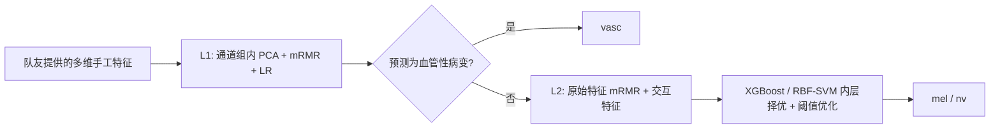

# Skin Lesion Classification · Traditional Machine Learning

**基于团队多维手工特征的分类器设计与性能优化。**

这是皮肤病变三分类课程项目中传统机器学习部分的个人贡献展示。我的工作从队友提供的形状、颜色和纹理特征出发，完成分类器对比、层次分类设计、特征筛选、非对称 PCA 与交互特征优化。分类目标为黑色素瘤 `mel`、色素痣 `nv` 和血管性病变 `vasc`。

## 核心设计

两个分类任务使用不同的特征空间：第一层识别血管性病变，采用通道组内 PCA 降维；第二层区分黑色素瘤和色素痣，保留原始特征空间，并增加交互特征。



- **层次分类**：将三分类拆成 vasc / 非 vasc，以及 mel / nv 两个子任务。
- **非对称 PCA**：按任务选择是否降维，避免强制两层共用同一种特征表示。
- **分类阶段特征优化**：mRMR 近似筛选结合 ICC 和先验权重；二层探索乘积、比值、差值交互。
- **模型与阈值优化**：二层比较 XGBoost 与 SVM，并在内层分组验证中选择决策阈值。

完整原代码在 [original_method/](original_method/)，复核入口在 [reassessment/](reassessment/)。这些内容保留原算法配置，与此前简化的工程示例分开。

## 原方法的结果

原课程评估记录为 **Macro-F1 0.789、Balanced Accuracy 0.815**。收到原始数据集后，重新核对图像、掩膜、特征与模型结果；复核记录见 [原始数据与方法复核报告](reports/reassessment/README.md)。

**原图重提的特征 CSV 与原缓存逐字节一致；原配置精确复现 0.789039。** 不使用测试标签生成交互特征、且 ICC 仅用外层训练折计算时，Macro-F1 仍为 **0.787922**。

| 复核配置 | Macro-F1 |
| --- | ---: |
| 完整原方法：训练折 ICC、无标签交互 | **0.788** |
| 关闭 L1 PCA | 0.753 |
| 关闭交互特征 | 0.782 |
| 原固定参数基线中的最好结果：LR | 0.720 |

上述配置使用同一外层分组；完整方法比关闭 L1 PCA 高约 3.49 个百分点，比关闭交互高约 0.56 个百分点。基线没有与完整方法相同的调参预算，差距不归因于单一架构因素。


| 指标 | 原课程记录 |
| --- | ---: |
| Accuracy | 0.772 |
| Macro-F1 | **0.789** |
| Balanced Accuracy | **0.815** |
| mel recall | 0.724 |
| nv recall | 0.743 |
| vasc recall | 0.978 |

原始数据包含 600 张图像，对应 200 个原图 ID，每个 ID 含原图和两个增强视图。874 个原始数值特征清理 4 个常数列后，得到 **870 维**特征。外层评估按原图 ID 做五折分组，同一原图及其增强视图不跨训练集与测试集。

这是该课程数据集和评估设置下的结果。外层分组验证、内层模型选择以及已知实现限制见 [评估说明](docs/EVALUATION.md)；不将其表述为独立患者测试或临床验证成绩。

## 我的贡献

| 工作 | 个人贡献 |
| --- | --- |
| 分类器对比 | LR、RBF-SVM、Random Forest、Gradient Boosting、KNN |
| 分类架构 | 两层分类器，以及 XGBoost / SVM 二层模型选择 |
| 性能优化 | 分类阶段的特征筛选、非对称 PCA、交互特征与阈值实验 |
| 实验分析 | 类别平衡指标、各类召回率、误差分析及配置对照 |

图像预处理和多维特征提取属于团队上游工作，作为本模块的输入依赖保留。后续添加的命令行、测试和原始数据复核属于工程整理，不倒推为原课程阶段已完成的工作。可用于个人主页的介绍见 [贡献说明](docs/CONTRIBUTIONS.md)。

## 复核原方法

在仓库根目录执行，数据目录需包含 `image/`、`mask/`、`label.csv`：

```bash
python -m pip install -e ".[original]"

# 从原图重新提取特征，不读取旧缓存
python reassessment/assess_original.py --source original_method --data data/private/Data_Proj2 --output outputs/original-reassessment --stage extract

# 保留原模型与参数，复现并做最小修改对照
python reassessment/assess_original.py --source original_method --data data/private/Data_Proj2 --output outputs/original-reassessment --stage evaluate

# 原五类基线；特征预选改为仅在各训练折拟合
python reassessment/assess_original.py --source original_method --data data/private/Data_Proj2 --output outputs/original-reassessment --stage baselines
```

默认评估包括原配置、训练折 ICC 配置、关闭 L1 PCA 和关闭交互特征。每个模型同时产生原逻辑预测与不使用测试标签的交互特征预测；具体差异和汇总在复核报告中说明。数据和逐样本输出均不随仓库发布。

无需原数据的可运行工程示例见 [ENGINEERING.md](ENGINEERING.md)。其中的简化配置和 F-test 成绩与原方法分开报告，不能用来判定原方法失效。

## 仓库结构

```text
skin-lesion-ml/
├── original_method/       # 原方法完整模块；仅适配数据路径
├── reassessment/          # 数据核对、重提、原方法与成对对照入口
├── reports/reassessment/  # 复核证据、汇总与实验限制
├── reports/historical/    # 原课程聚合结果及来源校验
├── src/skin_lesion_ml/    # 后续独立工程示例
├── tests/                # 工程示例回归测试
├── data/                 # 数据契约与合成示例
└── docs/                 # 方法归属、评估协议
```

仓库不包含真实数据和预训练模型。团队代码的许可范围尚未指定。
