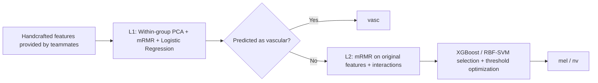
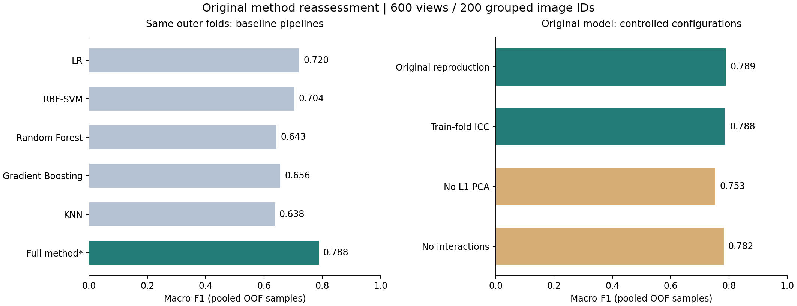

# Skin Lesion Classification · Traditional Machine Learning

**English** | [简体中文](README.zh-CN.md)

**Classifier design and performance optimization using multidimensional handcrafted features.**

This repository presents my contribution to the traditional machine learning component of a team course project on skin lesion classification. Starting from shape, color, and texture features extracted by teammates, I worked on classifier comparison, hierarchical classification, feature selection, asymmetric PCA, and interaction features.

The task is to distinguish melanoma (`mel`), melanocytic nevi (`nv`), and vascular lesions (`vasc`).

## Method

The two classification stages use different feature spaces. The first stage identifies vascular lesions using PCA within feature-channel groups. The second stage distinguishes melanoma from nevi using the original feature space and additional interaction features.



- **Hierarchical classification:** decompose the task into vascular versus nonvascular classification, followed by melanoma versus nevus classification.
- **Asymmetric PCA:** apply dimensionality reduction according to the needs of each stage.
- **Feature optimization:** combine approximate mRMR selection with intraclass correlation coefficient (ICC) and prior-based weights; explore product, ratio, and difference interactions in the second stage.
- **Model and threshold optimization:** compare XGBoost and SVM in the second stage and select its decision threshold using inner grouped validation.

The original implementation is preserved in [original_method/](original_method/), with reassessment scripts in [reassessment/](reassessment/). These retain the original algorithm configuration and are separate from the later simplified engineering example.

## Results and reproducibility

The original course evaluation reported **Macro-F1 of 0.789** and **balanced accuracy of 0.815**. Subsequent reassessment checked the source images, masks, feature extraction, and classifier outputs.

**The feature CSV regenerated from all source images is byte-for-byte identical to the original cache. The original configuration reproduced Macro-F1 = 0.789039.** Computing test interactions without test labels and estimating ICC using only each outer training fold yielded **Macro-F1 = 0.787922**.

| Reassessment configuration | Macro-F1 |
| --- | ---: |
| Full original method: training-fold ICC and label-independent test interactions | **0.788** |
| Without L1 PCA | 0.753 |
| Without interaction features | 0.782 |
| Best original fixed-parameter baseline: Logistic Regression | 0.720 |

All configurations use the same outer group splits. The full method exceeds the configuration without L1 PCA by approximately **3.49 percentage points**, and the configuration without interactions by **0.56 percentage points**. The baselines have a smaller tuning budget than the full method, so their performance gap cannot be attributed to the classification architecture alone.



| Metric | Original course result |
| --- | ---: |
| Accuracy | 0.772 |
| Macro-F1 | **0.789** |
| Balanced accuracy | **0.815** |
| Melanoma recall | 0.724 |
| Nevus recall | 0.743 |
| Vascular lesion recall | 0.978 |

The dataset contains **600 images representing 200 original image IDs**, each with an original image and two augmented views. Removing four constant columns from 874 raw numerical features produces **870 features**. Outer evaluation uses five-fold GroupKFold by original image ID, keeping each original image and its augmented views in the same fold.

These results apply to this course dataset and evaluation procedure. They are not independent patient-level test results or clinical validation. The [reassessment report](reports/reassessment/README.md) and [evaluation notes](docs/EVALUATION.md) document the evidence, inner model-selection procedure, and remaining implementation limitations. Supporting reports are currently in Chinese.

## My contribution

| Area | My work |
| --- | --- |
| Classifier comparison | Logistic Regression, RBF-SVM, Random Forest, Gradient Boosting, and KNN |
| Classification architecture | Two-stage classifier and second-stage XGBoost / SVM model selection |
| Performance optimization | Classification-stage feature selection, asymmetric PCA, interaction features, and threshold experiments |
| Experimental analysis | Class-balanced metrics, per-class recall, error analysis, and configuration comparisons |

**Image preprocessing and handcrafted feature extraction were upstream team contributions.** Those modules are included as dependencies of the classification workflow. The command-line interfaces, tests, and source-data reassessment were added during later repository preparation; they are not presented as work completed during the original course project.

Additional contribution details are available in [docs/CONTRIBUTIONS.md](docs/CONTRIBUTIONS.md).

## Reproduce the original method

Run the following commands from the repository root. The private dataset directory must contain `image/`, `mask/`, and `label.csv`.

```bash
python -m pip install -e ".[original]"

# Regenerate features from source images without loading the old cache.
python reassessment/assess_original.py --source original_method --data data/private/Data_Proj2 --output outputs/original-reassessment --stage extract

# Reproduce the original models and run controlled reassessment configurations.
python reassessment/assess_original.py --source original_method --data data/private/Data_Proj2 --output outputs/original-reassessment --stage evaluate

# Evaluate the five original baselines with feature selection fitted within each training fold.
python reassessment/assess_original.py --source original_method --data data/private/Data_Proj2 --output outputs/original-reassessment --stage baselines
```

The default evaluation includes the original configuration, training-fold ICC, removal of L1 PCA, and removal of interaction features. For each fitted model, it records both the original prediction logic and predictions using test interactions computed without test labels. Their differences are documented in the reassessment report.

For an executable example that does not require the private dataset, see [ENGINEERING.md](ENGINEERING.md). Its simplified models and F-test results are reported separately and are not an equivalent reproduction of the original method.

## Repository structure

```text
skin-lesion-ml/
├── original_method/       # Original modules; only the data-path configuration is adapted
├── reassessment/          # Data checks, feature regeneration, and paired reassessment
├── reports/reassessment/  # Reproduction evidence, results, and limitations
├── reports/historical/    # Original aggregate results and provenance
├── src/skin_lesion_ml/    # Later simplified engineering example
├── tests/                 # Regression tests for the engineering example
├── data/                  # Input contract and synthetic demonstration data
└── docs/                  # Contribution and evaluation documentation
```

Private images, real feature tables, per-sample outputs, and pretrained models are excluded from this repository. A license for the team code has not yet been specified.
